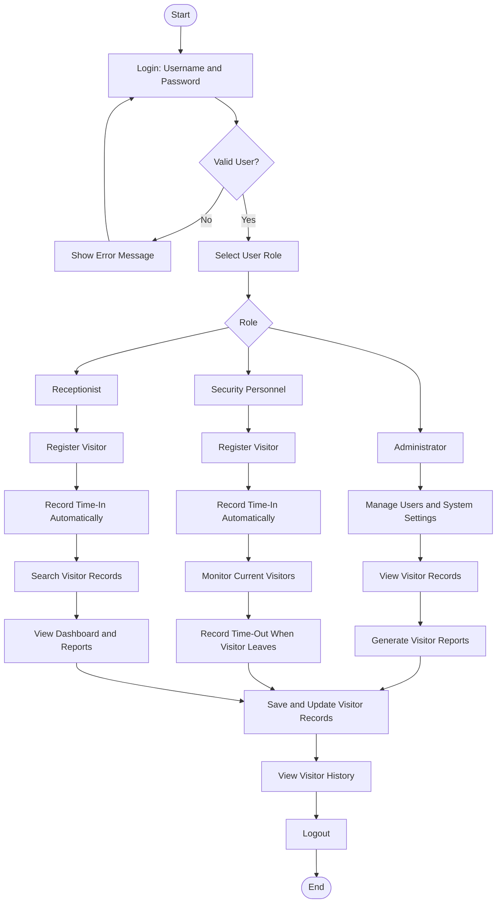
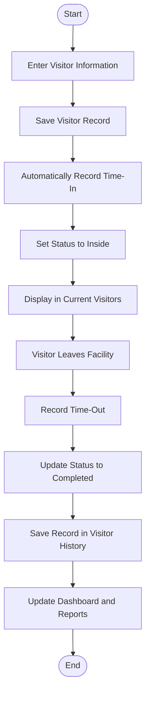

# Visitor Log Management System

## Description

A digital visitor registration system that records visitor information and monitors entry and exit times.

## Main Features

1. **Visitor Registration** — Record visitor name, contact information, purpose of visit, and person to visit.
2. **Time-In Recording** — Automatically record the visitor's arrival date and time.
3. **Time-Out Recording** — Record departure time when the visitor leaves.
4. **Visitor History** — Maintain a searchable history of visitor records.
5. **Visitor Search** — Search records by visitor name, date, or purpose.
6. **Current Visitor Monitoring** — Display visitors who are currently inside the facility.
7. **Visitor Reports** — Generate daily, weekly, and monthly visitor summaries.
8. **Dashboard** — Display total visitors, current visitors, and completed visits.

## User Roles

- **Administrator:** Manages users, visitor records, reports, and system settings.
- **Security Personnel:** Registers visitors, records time-in and time-out, and monitors visitors inside the facility.
- **Receptionist:** Registers visitors, searches visitor records, generates reports, and views the dashboard, depending on assigned permissions.

## System Flowchart

## Main Visitor Process

## Basic System Rules

- The system should record the arrival date and time automatically.
- Only visitors with an active visit should appear in the **Current Visitors** list.
- When a visitor leaves, the system records the time-out and changes the status from **Inside** to **Completed**.
- Visitor records should be searchable by name, date, and purpose of visit.
- Reports should summarize visitor activity by day, week, and month.
- User access should be based on the permissions assigned to each role.
